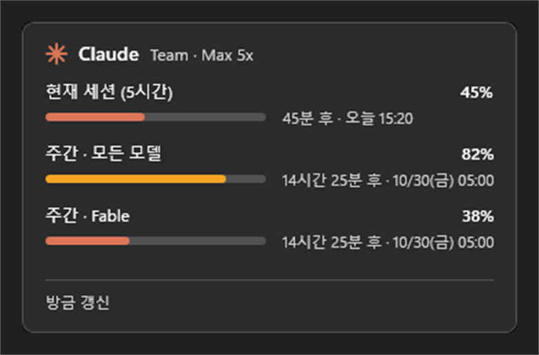
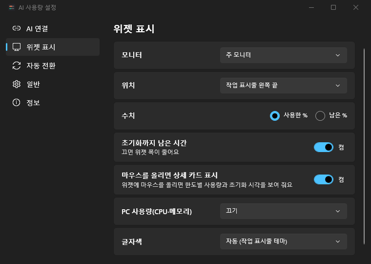
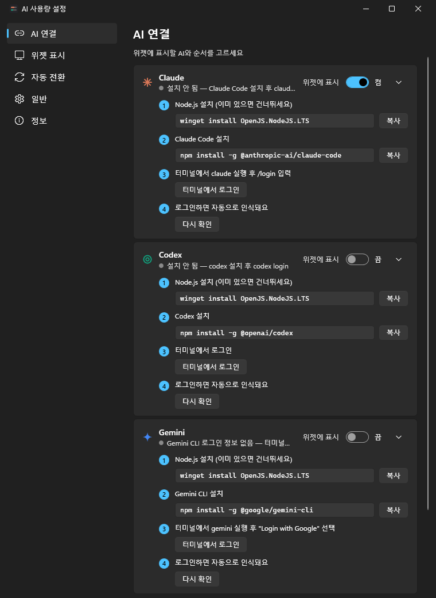

# AI 사용량 작업 표시줄 위젯 (AITokenUsage)

Windows 11 작업 표시줄 안에 **Claude · Codex · Gemini CLI · GitHub Copilot**의 구독 사용량(5시간·주간·일간·월간 한도 %)을 2줄 미니바로 보여 주는 작은 WPF 위젯입니다. 한 번에 AI 하나를 보여 주고 몇 초마다 다음 AI로 넘깁니다.

<p align="center">
  
  &nbsp;&nbsp;
  
</p>

왼쪽이 작업 표시줄 위젯, 오른쪽이 마우스를 올리면 나오는 상세 카드입니다(위젯 이미지는 투명한 배경을 어두운 작업 표시줄 색으로 채운 것입니다).

## 기능

- **작업 표시줄 위젯**: 176×40 DIP, "초기화까지 남은 시간"을 켜면 218×40 DIP. 배경은 투명합니다. 작업 표시줄의 자식 창으로 붙고, 실패하면 작업 표시줄이 소유하는 창(overlay)으로 대신 표시합니다.
- **2줄 미니바**: AI마다 표시할 두 한도를 고를 수 있습니다(예: Claude 5시간 세션 / 주간, Codex 5시간 / 주간, Gemini Pro / Flash, Copilot 월간 / 리셋 날짜). 75% 이상은 주황, 90% 이상은 빨강(공급자가 등급을 주면 그 값)입니다.
- **초기화까지 남은 시간**: 각 줄의 % 오른쪽에 한도가 초기화될 때까지 남은 시간을 `4h12m`, `2d3h`처럼 짧게 보여 줍니다. **설정 → 위젯 표시 → 초기화까지 남은 시간**에서 끄면 위젯 폭이 176 DIP로 줄어듭니다.
- **PC 사용량(CPU·메모리)**: PC 전체 CPU·메모리 사용률을 2초마다 보여 줍니다. **설정 → 위젯 표시 → PC 사용량**에서 끄기(기본) / 전환 패널(AI들 뒤에 PC 패널 추가) / 위젯 옆에 항상(위젯이 64 DIP 넓어짐) / 상세 카드·툴팁에만 중 고릅니다.
- **자동 전환**: 2–60초 간격(기본 5초), 220ms 슬라이드. 왼쪽 클릭·휠로 수동 전환, 마우스를 올리면 멈춤. 연결 안 된 AI는 건너뛸 수 있습니다.
- **상세 카드**: 위젯에 마우스를 0.4초 올리면 한도별 넓은 바, 리셋 시각(`3시간 12분 후 · 오늘 15:50`), 플랜, Claude 추가 사용량, 마지막 갱신·재시도 시각을 보여 줍니다. 필요 없으면 **설정 → 위젯 표시 → 마우스를 올리면 상세 카드 표시**를 꺼서 끌 수 있습니다.
- **설정 창**: 바꾸면 바로 적용·저장됩니다. 페이지는 다섯 가지입니다.
  - **AI 연결**: AI별 연결 상태와 단계별 안내, 위젯에 표시할지 여부, 순서, 1줄·2줄에 보여 줄 한도.
  - **위젯 표시**: 모니터, 위치(작업 표시줄 왼쪽 끝 / 시작 버튼 왼쪽 / 알림 영역 왼쪽), 사용한 %·남은 %, 초기화까지 남은 시간, 마우스를 올리면 상세 카드 표시, PC 사용량(CPU·메모리), 글자색(자동 / 밝게 / 어둡게).
  - **자동 전환**: 여러 AI 자동으로 넘기기, 전환 간격, 마우스 올리면 멈춤, 연결 안 된 AI 건너뛰기.
  - **일반**: 언어(자동 / 한국어 / English), 새로고침 간격(2/5/10/15분), Windows 시작 시 자동 실행, 트레이 아이콘 표시.
  - **정보**: 버전, 비공식 API 안내, 로그 폴더 열기, 설정 파일 위치.

  

- **트레이 아이콘**: 현재 AI의 1줄 값을 숫자로 그립니다(PC 패널이 현재 표시 중이면 CPU %). 왼쪽 클릭은 설정 창, 오른쪽 클릭은 `설정…` · `지금 새로고침` · `자동 전환 일시정지` · `종료`.
- **견고함**: 마지막 정상 값을 캐시해 시작 즉시 보여 주고, 조회가 실패하면 흐리게 표시합니다. 요청 제한(429)이면 지수 백오프로 기다립니다.

## 요구 사항

- Windows 11 24H2 또는 25H2, x64, **가로(아래쪽) 작업 표시줄**
- 설치 프로그램으로 설치하면 .NET을 따로 설치할 필요가 없습니다(런타임 포함).
- 직접 빌드: .NET 10 SDK, [Inno Setup 6](https://jrsoftware.org/isinfo.php)
- 보려는 AI 도구에 로그인해 두어야 합니다. 설치·로그인 방법은 아래 [AI 연결 방법](#ai-연결-방법)을 보세요.

관리자 권한은 필요 없습니다.

## 설치

1. GitHub Releases 또는 직접 빌드한 `AITokenUsage-Setup-<버전>.exe`를 실행합니다.
2. SmartScreen 경고가 나오면 **추가 정보 → 실행**을 누릅니다(서명되지 않은 프로그램이라 나오는 경고입니다).
3. 설치 마법사는 한국어·영어를 지원하고 Windows 언어에 맞춰 자동 선택합니다. "Windows 시작 시 자동 실행"과 바탕화면 아이콘은 선택 항목이며 기본은 꺼져 있습니다.

관리자 권한은 필요 없고, 기본 설치 위치는 `%LOCALAPPDATA%\Programs\AITokenUsage`입니다. 제거는 **설정 → 앱**에서 하며, 제거할 때 설정과 캐시도 지울지 묻습니다. AI CLI의 로그인 파일은 건드리지 않습니다.

## AI 연결 방법

**설정 → AI 연결** 페이지에서 AI마다 연결 상태를 볼 수 있습니다. 연결되지 않은 AI는 카드에 단계별 안내가 나오고, 명령은 [복사]로 복사하거나 [터미널에서 로그인]으로 바로 실행할 수 있습니다. 로그인하면 자동으로 인식됩니다(바로 확인하려면 [다시 확인]).



| AI | 설치 | 로그인 |
|---|---|---|
| Claude | `npm install -g @anthropic-ai/claude-code` | `claude` 실행 후 `/login` (Pro/Max/Team/Enterprise 구독) |
| Codex | `npm install -g @openai/codex` | `codex login` (ChatGPT 계정) |
| Gemini | `npm install -g @google/gemini-cli` | `gemini` 실행 후 "Login with Google" 선택 (Workspace Code Assist 계정) |
| Copilot | 별도 설치 없음 | 설정 창의 **GitHub 로그인**(기기 코드), 또는 `gh auth login` · Copilot CLI · VS Code 계열 Copilot |

Claude·Codex·Gemini 설치에는 Node.js가 필요합니다: `winget install OpenJS.NodeJS.LTS`

## 언어

**설정 → 일반 → 언어**에서 자동(Windows 설정) / 한국어 / English를 고릅니다. 바꾼 뒤에는 앱을 다시 시작해야 적용되며, 같은 페이지의 [지금 다시 시작]으로 바로 다시 시작할 수 있습니다.

## 직접 빌드

개발용 빌드와 실행은 저장소 루트에서:

```powershell
dotnet build AITokenUsage.sln
dotnet test AITokenUsage.sln
dotnet run --project src/AITokenUsage
```

창 없이 시작해 작업 표시줄에 위젯이, 알림 영역에 트레이 아이콘이 나타납니다. 이미 실행 중일 때 다시 실행하면 새로 뜨지 않고 설정 창을 엽니다.

설치 프로그램은 Inno Setup으로 만듭니다.

```powershell
winget install JRSoftware.InnoSetup
powershell -ExecutionPolicy Bypass -File tools\Build-Installer.ps1
```

이 스크립트는 테스트를 돌리고, 런타임을 포함한 self-contained 배포본(`artifacts\publish`)을 만든 뒤, `artifacts\installer\AITokenUsage-Setup-<버전>.exe`를 만듭니다. 테스트를 건너뛰려면 `-SkipTests`를 붙입니다. 버전은 `Directory.Build.props`의 `<Version>` 한 곳에서 관리합니다.

앱 아이콘을 다시 만들려면:

```powershell
powershell -NoProfile -ExecutionPolicy Bypass -File tools/New-AppIcon.ps1
```

## 데이터 출처

| AI | 읽는 자격 증명 (읽기 전용) | 호출하는 곳 |
|---|---|---|
| Claude | 폴더 안의 `.credentials.json`. 폴더는 `CLAUDE_SECURESTORAGE_CONFIG_DIR`가 정의돼 있으면 그 값(빈 값이면 `%USERPROFILE%\.claude`), 없으면 `CLAUDE_CONFIG_DIR`, 둘 다 없으면 `%USERPROFILE%\.claude` | `GET https://api.anthropic.com/api/oauth/usage` |
| Codex | `%USERPROFILE%\.codex\auth.json` (`CODEX_HOME`) | `GET https://chatgpt.com/backend-api/wham/usage`, 토큰이 오래되면 `codex app-server`(15분에 1회), 마지막 대체로 `sessions\**\rollout-*.jsonl` 로그 |
| Gemini | `%USERPROFILE%\.gemini\oauth_creds.json` 또는 Windows 자격 증명 관리자 `gemini-cli-oauth/main-account` | `POST https://cloudcode-pa.googleapis.com/v1internal:loadCodeAssist`, `…:retrieveUserQuota` |
| Copilot | 앱의 GitHub 로그인 토큰, `COPILOT_GITHUB_TOKEN`/`GH_TOKEN`/`GITHUB_TOKEN`, `gh auth token`, 자격 증명 관리자 `copilot-cli*`, `%LOCALAPPDATA%\github-copilot\apps.json`·`hosts.json` | `GET https://api.github.com/copilot_internal/user` |

### 비공식 API 주의

위 사용량 엔드포인트는 모두 **공개 문서가 없는 비공식 API**입니다. 각 CLI·IDE가 내부적으로 쓰는 것을 같은 방식으로 호출할 뿐이며, 예고 없이 바뀌거나 막힐 수 있습니다. 바뀌면 위젯은 "오류"와 마지막 정상 값으로 버티고, 파서를 고쳐야 다시 정상 표시됩니다. Copilot의 GitHub 로그인은 Copilot GitHub App의 공개 클라이언트 ID로 기기 코드 흐름을 씁니다. 사용 여부는 각 서비스 약관을 확인하고 본인 판단으로 결정하세요.

Claude의 사용량 API는 Claude Code와 같은 요청 한도를 공유하므로, 새로고침 간격을 너무 짧게 하지 않는 것이 좋습니다(최소 2분, 기본 5분).

### Gemini OAuth 클라이언트

Gemini 토큰을 갱신하려면 Gemini CLI의 Google OAuth 클라이언트가 필요합니다. 이 저장소에는 Google OAuth 클라이언트 ID·시크릿을 **포함하지 않습니다.** 앱은 실행할 때 PC에 설치된 gemini-cli(`%APPDATA%\npm\node_modules\@google\gemini-cli` 등의 번들·`oauth2.js`)에서 클라이언트 값을 찾아 메모리에서만 쓰며, 찾지 못하면 토큰 갱신을 하지 않습니다. 환경 변수 `GEMINI_OAUTH_CLIENT_ID`/`GEMINI_OAUTH_CLIENT_SECRET`를 둘 다 지정하면 그 값을 우선 씁니다. 이 값은 파일이나 로그에 남기지 않습니다.

## 보안과 개인정보

- CLI의 자격 증명 파일에는 **절대 쓰지 않습니다.** 다른 프로그램이 쓰는 중에도 공유 모드로 읽기만 합니다.
- Claude·Codex 토큰을 직접 갱신(refresh)하지 않습니다. 만료가 가까우면 CLI가 갱신할 때까지 기다립니다. Gemini만 메모리 안에서 갱신하고 파일에 쓰지 않습니다.
- 토큰, `Authorization` 헤더, API 응답 원문은 로그·캐시·오류 메시지에 남기지 않습니다.
- 앱이 직접 받은 Copilot 토큰은 DPAPI(현재 사용자)로 암호화해 저장하고, 설정 창의 [로그아웃]으로 지웁니다.

## 저장 위치

| 파일 | 내용 |
|---|---|
| `%APPDATA%\AITokenUsage\settings.json` | 설정 |
| `%LOCALAPPDATA%\AITokenUsage\cache.json` | 공급자별 마지막 정상 사용량(토큰 없음) |
| `%LOCALAPPDATA%\AITokenUsage\copilot-token.bin` | GitHub 로그인 토큰(DPAPI) |
| `%LOCALAPPDATA%\AITokenUsage\logs\app.log` | 로그(1MB마다 교체, 3개 보존) |

## 알려진 한계

- **Codex, Gemini CLI, Copilot은 실제 계정으로 검증하지 못했습니다.** 개발 PC에는 Claude Code만 로그인돼 있어, 세 공급자는 조사 보고서의 실제 응답 형태로 만든 샘플 데이터 단위 테스트로만 확인했습니다. 실제 계정에서 "설치 안 됨"·"로그인 필요" 외의 표시가 이상하면 이슈로 알려 주세요.
- **Antigravity는 지원하지 않습니다.** Gemini 개인 계정의 Code Assist 지원 종료(2026-06-18) 이후 개인 계정은 "개인 계정 지원 종료 — Antigravity 사용"으로만 표시됩니다.
- **세로(왼쪽/오른쪽) 작업 표시줄은 지원하지 않습니다.** 이때와 작업 표시줄에 자리가 부족할 때는 위젯을 숨기고 트레이 아이콘만 남깁니다.
- 위젯은 모니터 한 개에만 표시합니다(설정에서 고를 수 있음).
- Copilot 언어 서버의 `auth.db`, Gemini의 암호화 파일 저장소(`gemini-credentials.json`)는 읽지 않습니다.
- 자식 창 임베딩은 Windows 빌드나 보안 프로그램에 따라 실패할 수 있습니다. 그때는 overlay 모드로 표시하고 10초마다 다시 붙기를 시도합니다.

## 문제 해결

- **위젯이 안 보임**: 세로 작업 표시줄, 공간 부족, 전체 화면 앱, 작업 표시줄 자동 숨김일 수 있습니다. 트레이 아이콘 왼쪽 클릭으로 설정 창을 열어 위치·모니터를 바꿔 보세요.
- **값이 흐리게 보임**: 마지막 조회가 실패해 이전 값을 보여 주는 중입니다. 위젯에 마우스를 올려 상세 카드 아래쪽의 이유와 재시도 시각을 확인하세요(카드가 안 뜨면 **설정 → 위젯 표시**에서 "마우스를 올리면 상세 카드 표시"가 켜져 있는지 확인하세요).
- **로그**: `%LOCALAPPDATA%\AITokenUsage\logs\app.log`

## 라이선스

Copyright © 2026 [DDongYeop](https://github.com/DDongYeop)

[MIT 라이선스](LICENSE)로 배포합니다. 저작권 표시와 라이선스 문구를 남기면 자유롭게 사용·수정·재배포할 수 있습니다.
